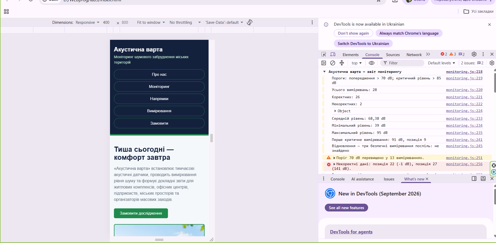
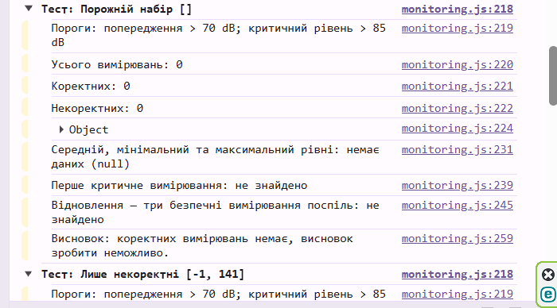
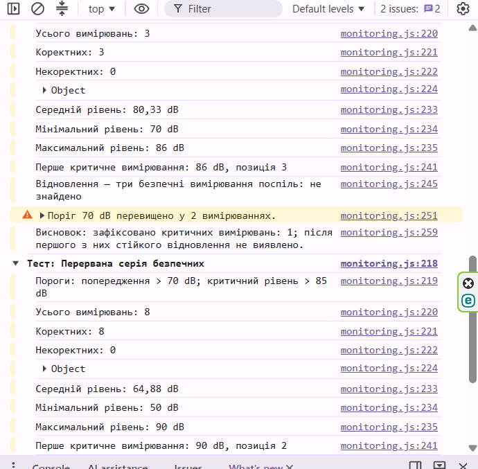
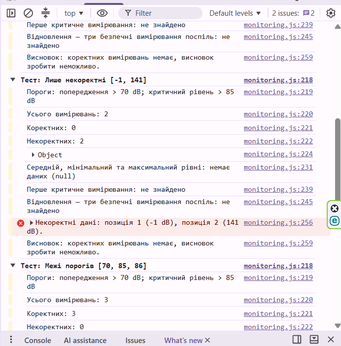

# Лабораторна робота №4
## Робота з циклами, функціями та функціональними виразами в JavaScript. Консоль браузера

**Дисципліна:** WEB-програмування
**Виконала:** Половко Аліна, група КН-42

## Мета роботи
Реалізувати та пояснити алгоритм аналізу послідовності вимірювань шуму: від перевірки даних і циклів до декомпозиції на функції та синхронної передачі функції як аргументу.

## Опис проєкту
Продовження проєкту «Акустична варта». До сторінки додано один зовнішній скрипт `js/monitoring.js`, який аналізує масив вимірювань рівня шуму (у dB) і друкує звіт у консолі браузера. Скрипт не змінює сторінку.

## Структура проєкту
```
lab-4/
├── index.html
├── assets/
├── css/
├── scss/
├── js/
│   └── monitoring.js
├── screenshots/
│   └── console.png
└── README.md
```

Скрипт підключено в `<head>`:
```html
<script src="./js/monitoring.js" defer></script>
```
Атрибут `defer` завантажує файл паралельно з розбором HTML і запускає його після завершення розбору.

## Вихідні дані
- масив із 28 вимірювань (два некоректні: -1 і 141);
- `warningLevel = 70`, `criticalLevel = 85`;
- коректним вважається скінченне число від 30 до 130 dB включно.

## Що реалізовано

**Цикли**
- `for...of`: підрахунок кількості, суми, категорій, мінімуму та максимуму; некоректні записи пропускаються через `continue`;
- `for` з індексом і `break`: пошук першого критичного вимірювання та його позиції;
- `while`: пошук відновлення (три коректні безпечні вимірювання поспіль після першого критичного);
- `do...while`: пошук першого коректного вимірювання в непорожньому масиві.

**Функції (декомпозиція)**
- `isValidLevel()`: перевірка коректності, повертає `true`/`false`;
- `calculateAverage()`, `findMinimum()`, `findMaximum()`: повертають значення або `null`;
- `findFirstCritical()`, `findRecovery()`, `findFirstValid()`;
- `countByCategory()`, `findInvalidRecords()`, `analyze()`;
- `printReport()` лише друкує результат, обчислення відокремлені від виводу.

**Три форми запису функцій**
- Function Declaration: `isValidLevel`, `findFirstCritical`;
- Function Expression: `const countByCategory = function (...) {...}`, передається у функцію `analyze` як аргумент (callback);
- Arrow Function: `statusLabel = value => ...` (один параметр) та `isAbove = (value, threshold) => ...` (кілька параметрів).

**Hoisting.** Function Declaration можна викликати до її оголошення в коді, бо вона піднімається. Function Expression, записана в `const`, доступна лише після рядка ініціалізації, виклик раніше дає `ReferenceError: Cannot access 'countByCategory' before initialization`.

**Чому `do...while`.** Для непорожнього масиву перше значення треба перевірити хоча б один раз, тому тіло циклу виконується до першої перевірки умови.

## Результат у консолі

Звіт для основного набору даних:

| Показник | Значення |
|---|---|
| Усього вимірювань | 28 |
| Коректних | 26 |
| Некоректних | 2 (позиція 22: -1 dB, позиція 27: 141 dB) |
| Без перевищення | 13 |
| Попередження | 9 |
| Критичні | 4 |
| Середній рівень | 68,38 dB |
| Мінімум / максимум | 39 dB / 95 dB |
| Перше критичне | 91 dB, позиція 9 |
| Відновлення | не знайдено |

Додатково перевірено окремі набори даних: `[]`, `[-1, 141]`, `[70, 85, 86]` та послідовність із перерваною серією безпечних вимірювань. Основний масив при цьому не змінювався.

### Скріншот консолі

![Звіт у консолі браузера]




## Посилання
- Репозиторій: https://github.com/apolovko2023-bit/WEBprog
- Опублікований сайт: https://apolovko2023-bit.github.io/WEBprog/lab3/ (звіт відображається в Console, F12)

## Висновки
У ході лабораторної роботи я реалізувала алгоритм аналізу вимірювань шуму на JavaScript. Я використала цикли `for`, `for...of`, `while` та `do...while`, команди `break` і `continue`, розділила алгоритм на функції з параметрами та `return`, застосувала Function Declaration, Function Expression і Arrow Function, розібралась із hoisting та передачею функції як аргументу. Результат виводиться в консоль браузера за допомогою `console.group`, `console.table`, `console.warn` і `console.error`.