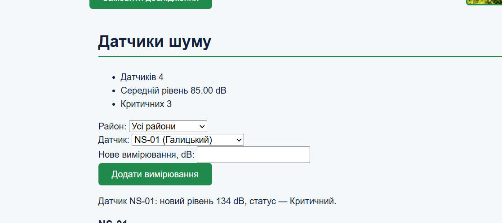
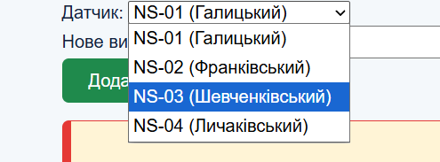

# Лабораторна робота №5
## Проєктування системи класів у JavaScript

**Дисципліна:** WEB-програмування
**Виконала:** Половко Аліна, група КН-42

## Мета роботи
Навчитися переходити від набору окремих об'єктів і функцій до системи взаємопов'язаних класів: виділяти сутності предметної області, визначати їх стан і поведінку, розподіляти відповідальності, будувати композицію, обґрунтовано використовувати наслідування та інтегрувати об'єктну модель у наявний вебпроєкт.

## Опис проєкту
Продовження проєкту «Акустична варта». JavaScript-частину відрефакторено: дані датчиків шуму, які раніше зберігались у звичайних об'єктах і оброблялись окремими функціями, тепер є екземплярами класів, а логіку моніторингу виконує окремий клас-сервіс. HTML-структура та стилі залишились базою, змінилась лише організація даних і логіки в JavaScript. Картки датчиків на сторінці формуються з об'єктів `NoiseSensor`.

## Структура проєкту
```
lab-5/
├── index.html
├── assets/
├── css/
├── scss/
├── js/
│   ├── config.js
│   ├── models/
│   │   ├── NoiseSensor.js
│   │   ├── NoiseMeasurement.js
│   │   └── MobileNoiseSensor.js
│   ├── services/
│   │   └── MonitoringSystem.js
│   └── app.js
├── screenshots/
└── README.md
```

Скрипт підключено як ES-модуль:
```html
<script type="module" src="./js/app.js"></script>
```
Модулі працюють лише через сервер, тому проєкт запускається через VS Code → Live Server (`http://127.0.0.1:5500/`).

| Папка / файл | Відповідальність |
|---|---|
| `models/` | класи предметної області |
| `services/` | клас, що керує колекцією датчиків |
| `config.js` | централізовані межі шуму |
| `app.js` | створення об'єктів та інтеграція зі сторінкою |

## Вихідні дані
- три датчики: NS-01 (Галицький, 58 dB), NS-02 (Франківський, 74 dB), NS-03 (Шевченківський, 83 dB);
- межі класифікації в одному місці: `NOISE_LIMITS = { normalMax: 55, warningMax: 70 }`;
- коректним вважається скінченне число від 0 до 200 dB включно.

## Що реалізовано

**Проєктування**

| Клас | Стан | Поведінка | Взаємодіє з |
|---|---|---|---|
| `NoiseSensor` | `id`, `district`, `location`, `noiseLevel`, `measurements` | `getStatus()`, `updateNoiseLevel()`, `addMeasurement()`, static `isValidNoiseLevel()`, static `fromObject()` | `NoiseMeasurement`, `MonitoringSystem` |
| `NoiseMeasurement` | `value`, `measuredAt` | `isValid()`, `toString()` | `NoiseSensor` |
| `MonitoringSystem` | `sensors` | `addSensor()`, `findSensorById()`, `getSensorsByDistrict()`, `getCriticalSensors()`, `getAverageNoiseLevel()` | `NoiseSensor` |
| `MobileNoiseSensor` | + `batteryLevel` | `needsCharging()` | наслідує `NoiseSensor` |

Окремий клас для району не створювала: у проєкті це просто рядок без власного стану й правил.

**Схема зв'язків**
```
MonitoringSystem ──► sensors ──► NoiseSensor[]
                                    │
                                    └──► measurements ──► NoiseMeasurement[]

NoiseSensor ◄── MobileNoiseSensor (extends)
```

**Рефакторинг**
- `getSensorStatus(sensor)` → метод `NoiseSensor.getStatus()`;
- пряма зміна `sensor.noiseLevel = ...` → `NoiseSensor.updateNoiseLevel(value)` із перевіркою;
- пошук, фільтрація й середнє по масиву об'єктів → методи `MonitoringSystem`;
- числа `55` і `70` у різних функціях → один `NOISE_LIMITS`.

**Класи та екземпляри**
- `constructor` задає власний стан кожного датчика, масив `measurements` створюється в конструкторі, тому в кожного датчика окрема історія;
- `getStatus()` звертається до `NOISE_LIMITS`, числа 55 і 70 більше ніде не дублюються;
- `updateNoiseLevel()` спочатку перевіряє значення через static-метод і лише потім змінює стан;
- `addMeasurement()` приймає тільки `NoiseMeasurement`, додає його в історію й оновлює поточний `noiseLevel`.

**Static-методи.** `NoiseSensor.isValidNoiseLevel(value)` не потребує `this` конкретного датчика, бо перевіряє просто число. `NoiseSensor.fromObject(data)` створює екземпляр із звичайного об'єкта, тобто викликається ще до того, як екземпляр існує. Тому обидва методи належать класу, а не об'єкту. Для створення датчиків із `sensorsData` використала `map(NoiseSensor.fromObject)`: метод перевіряє обов'язкові поля, а `map` не потребує проміжних змінних.

**Композиція.** `MonitoringSystem` містить масив `NoiseSensor`, а кожен `NoiseSensor` містить масив `NoiseMeasurement`. Система працює з повноцінними об'єктами, а не з окремими числами. Дубль `id` та додавання не-`NoiseSensor` відхиляються помилкою.

**Наслідування.** `MobileNoiseSensor extends NoiseSensor` додає `batteryLevel` і метод `needsCharging()`. Перевірка реченням: «мобільний датчик є різновидом датчика шуму» (правильно), тому `extends` виправданий. `super(...)` викликається першим, бо до цього `this` у похідному класі недоступний.

**Колекція.** Для пошуку використано `find`, для вибірки `filter`, для середнього `reduce`. Для порожньої колекції середнє повертає `0`, тому немає `NaN`.

**Представлення.** `renderSensorCard(sensor)` залишилась окремою функцією в `app.js`, а не методом класу: створення HTML не є поведінкою фізичного датчика. Картка отримує CSS-клас `normal`, `warning` або `critical` за `sensor.getStatus()`.

## Консольні експерименти з класами

У `app.js` тимчасово виставлені в `window` класи й система (`NoiseSensor`, `NoiseMeasurement`, `MobileNoiseSensor`, `system`), щоб працювати з ними в Console.

### Експеримент 1. Два незалежні екземпляри
```js
const sensorA = new NoiseSensor("NS-01", "Галицький", "просп. Свободи", 58);
const sensorB = new NoiseSensor("NS-02", "Франківський", "вул. Наукова", 74);
sensorA.updateNoiseLevel(40);
console.log(sensorA.noiseLevel, sensorB.noiseLevel);
```
Очікується: `40 74`. Зміна стану одного екземпляра не впливає на інший.


### Експеримент 2. Prototype і власні властивості
```js
console.log(sensorA.getStatus === sensorB.getStatus);
console.log(Object.hasOwn(sensorA, "noiseLevel"));
console.log(Object.hasOwn(sensorA, "getStatus"));
```

| Вираз | Очікується |
|---|---|
| `sensorA.getStatus === sensorB.getStatus` | `true` |
| `Object.hasOwn(sensorA, "noiseLevel")` | `true` |
| `Object.hasOwn(sensorA, "getStatus")` | `false` |

`noiseLevel` записується в `this` у конструкторі й належить кожному екземпляру. `getStatus` лежить у `NoiseSensor.prototype` і є однією спільною функцією, яку екземпляри знаходять через прототипний ланцюжок.


### Експеримент 3. Де знаходиться метод
```js
console.log(Object.getPrototypeOf(sensorA) === NoiseSensor.prototype);
console.log(Object.hasOwn(NoiseSensor.prototype, "getStatus"));
console.log(Object.getOwnPropertyNames(sensorA));
```
Очікується: `true`, `true`, `['id', 'district', 'location', 'noiseLevel', 'measurements']`.


### Експеримент 4. Static-метод
```js
console.log(NoiseSensor.isValidNoiseLevel(74));
console.log(NoiseSensor.isValidNoiseLevel(-5));
console.log(typeof sensorA.isValidNoiseLevel);
sensorA.isValidNoiseLevel(74);
```
Очікується: `true`, `false`, `"undefined"`, а останній рядок дає `TypeError: sensorA.isValidNoiseLevel is not a function`. Static-метод доступний через клас, а не через екземпляр.


### Експеримент 5. Статуси та середнє
```js
system.sensors.forEach(s => console.log(s.id, s.getStatus()));
console.log(system.getAverageNoiseLevel());
```

| Датчик | Рівень | Очікується |
|---|---|---|
| NS-01 | 58 dB | `warning` |
| NS-02 | 74 dB | `critical` |
| NS-03 | 83 dB | `critical` |
| Середнє | | ≈ 71,67 dB |


### Експеримент 6. Методи MonitoringSystem
```js
system.findSensorById("NS-02");
system.findSensorById("NS-99");
system.getSensorsByDistrict("Галицький");
system.getCriticalSensors();
new MonitoringSystem().getAverageNoiseLevel();
```
Очікується: об'єкт NS-02; `undefined`; масив із NS-01; масив із NS-02 і NS-03; `0` для порожньої системи.


### Експеримент 7. Валідація й помилки
```js
try { sensorA.updateNoiseLevel(-10); } catch (e) { console.log(e.message); }
try { system.addSensor({ id: "X" }); } catch (e) { console.log(e.message); }
try { system.addSensor(system.findSensorById("NS-01")); } catch (e) { console.log(e.message); }
console.log(sensorA.noiseLevel);
```
Очікується: `Некоректний рівень шуму: -10`; `Можна додавати лише об'єкти NoiseSensor`; `Датчик NS-01 вже існує`; рівень залишається `40`. Стан не змінюється, якщо значення некоректне.


### Експеримент 8. Композиція: вимірювання
```js
const s = system.findSensorById("NS-01");
s.addMeasurement(new NoiseMeasurement(48));
s.addMeasurement(new NoiseMeasurement(61));
s.addMeasurement(new NoiseMeasurement(73));
console.log(s.measurements);
console.log(s.noiseLevel, s.getStatus());
```
Очікується: масив із 3 об'єктів `NoiseMeasurement`, `73 "critical"`. Рівень оновився, статус змінився автоматично.


### Експеримент 9. Наслідування
```js
const m = new MobileNoiseSensor("MS-01", "Личаківський", "вул. Зелена", 62, 15);
console.log(m instanceof MobileNoiseSensor, m instanceof NoiseSensor);
console.log(m.getStatus(), m.needsCharging());
console.log(Object.hasOwn(m, "batteryLevel"), Object.hasOwn(m, "needsCharging"));
```
Очікується: `true true`; `"warning" true`; `true false`. `getStatus` успадкований, `needsCharging` лежить у `MobileNoiseSensor.prototype`.


### Експеримент 10. Втрата `this`
```js
const fn = sensorA.getStatus;
fn();
```
Очікується: `TypeError: Cannot read properties of undefined (reading 'noiseLevel')`. Після відокремлення від об'єкта метод втрачає `this`. Виправлення: `sensorA.getStatus.bind(sensorA)`.


## Результат на сторінці

На сторінці відображається список карток датчиків: ID, район, адреса, рівень шуму та статус. Дані беруться з об'єктів `NoiseSensor`, що зберігаються в `MonitoringSystem`.

| Датчик | Район | Рівень | Статус | CSS-клас |
|---|---|---|---|---|
| NS-01 | Галицький | 58 dB | warning | `warning` |
| NS-02 | Франківський | 74 dB | critical | `critical` |
| NS-03 | Шевченківський | 83 dB | critical | `critical` |

Після додавання вимірювання й повторного рендерингу змінюються і значення, і клас картки.

### Скріншоти сторінки

Початковий стан:


Картки зі статусами normal / warning / critical:


Після додавання нового вимірювання:


Фільтрація за районом, критичні датчики та середнє значення:



## Відповіді на контрольні питання

1. **Клас і екземпляр.** Клас описує структуру й поведінку майбутніх об'єктів, екземпляр є конкретним об'єктом, створеним через `new`, зі своїм станом.
2. **`this.noiseLevel` і `getStatus()`.** `noiseLevel` записується в `this` у конструкторі, тому є власною властивістю екземпляра, а `getStatus()` лежить у прототипі.
3. **Де метод класу.** У `NoiseSensor.prototype`.
4. **Одна функція для двох екземплярів.** Обидва мають спільний прототип. Результат різний, бо залежить від `this`, тобто від стану конкретного датчика.
5. **Коли static.** Коли операція пов'язана з типом, але не потребує `this`, наприклад `NoiseSensor.isValidNoiseLevel(74)`.
6. **Чому не через екземпляр.** Static-метод належить класу, тому `sensor.isValidNoiseLevel` дорівнює `undefined`, а виклик дає `TypeError`.
7. **Стан і поведінка.** Стан це дані об'єкта (`id`, `noiseLevel`), поведінка це операції над ними (`getStatus()`, `updateNoiseLevel()`).
8. **Композиція і наслідування.** Композиція це відношення «містить» (система містить датчики), наслідування це «є різновидом» (мобільний датчик є датчиком).
9. **Перевірка `extends`.** Речення «X є різновидом Y».
10. **Навіщо `super()`.** Викликає конструктор батьківського класу й ініціалізує успадковану частину стану. До нього `this` у похідному класі недоступний.
11. **`renderSensorCard` не метод.** Створення HTML це логіка представлення, а не поведінка датчика, і модель не повинна залежати від DOM.
12. **Дублювання 55 і 70.** Під час зміни правил легко оновити одне місце й забути інше, тому статуси стануть суперечливими. Рішення це єдиний `NOISE_LIMITS`.
13. **`const fn = sensor.getStatus; fn()`.** Метод втрачає `this`, і виклик дає `TypeError`.
14. **Великий `MonitoringSystem` з усім.** Порушується єдина відповідальність: код важко розуміти, тестувати й змінювати, а клас не можна використати без DOM.
15. **Перевага екземплярів над plain objects.** Дані й поведінка разом: об'єкт сам знає свій статус і перевіряє нові значення, а код не залежить від форми об'єкта.

## Посилання
- Репозиторій: https://github.com/apolovko2023-bit/WEBprog
- Опублікований сайт: https://apolovko2023-bit.github.io/WEBprog/lab5/ (результат на сторінці, експерименти в Console, F12)

## Висновки
У ході лабораторної роботи я перетворила JavaScript-частину проєкту «Акустична варта» з набору функцій над звичайними об'єктами на систему класів. Я виділила сутності `NoiseSensor`, `NoiseMeasurement` і `MonitoringSystem`, розподілила між ними відповідальності, централізувала межі класифікації шуму в `NOISE_LIMITS` та реалізувала static-методи, композицію й наслідування (`MobileNoiseSensor`). Консольними експериментами перевірила різницю між власними властивостями екземпляра та методами в `prototype`, роботу static-методів і втрату `this`. Модель інтегрована в сторінку, а код розділено на `models`, `services` і `app.js`.